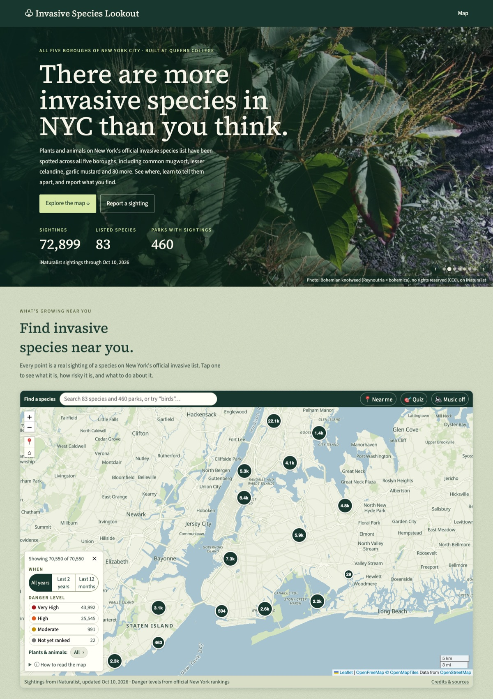

# Kissena Invasive Watch

An interactive map of **invasive species across Queens, New York City**, built at **HackKnight 2026** (Queens College). It started around Kissena Park and Queens College and now covers all of Queens: **76 New York–listed invasive species and 14,620 research-grade sightings**.

Every fact links to its source. Danger levels come from official New York rankings, never from AI.



## What you can do

- **Explore the map.** Sightings are grouped into numbered bubbles that split as you zoom in. Hover a bubble to preview the species inside; zoom to street level to see every sighting at its own spot.
- **Learn about a species.** Tap an icon to see photos, its danger level explained in plain words, its legal status in New York, when it shows up during the year, its history, how to handle it, and its sources. A real recording plays only for the few species that have one.
- **Search** any of the 76 species or 99 parks by name.
- **Browse** the same data as lists: a sortable table of **all species**, the **recently seen** sightings, and **near me** (species seen within 250 m – 1 km of you, or of an example place).
- **Share a link** to any view, like `/?park=Q024` (Kissena Park) or `/?species=6921` (Mute Swan). The browser's Back button works too.
- **See where each text came from**: every section says it was found by Snowflake Cortex Search in which fact sheet, and shown word for word. Fact sheets not yet checked by the team are marked "Draft".
- **Open a park profile**, for example Kissena Park: its official boundary, which listed species have been seen there, how dangerous they are, when people see them, and the latest sightings.
- **Filter** by danger level or type (plants, birds, insects, fish and shellfish, other animals), or switch to a **heat map**.
- **Report a sighting** to New York's official database (NY iMapInvasives) from any species or park.
- **Find me** shows where you are on the map; the location stays in your browser.

## How it works

```
 iNaturalist API ─────► scripts/fetch_*.py ────────┐
 NYS DEC Part 575 list ─► data/ny_invasive_list.csv │
 nyis.info rank forms ──► data/danger_levels.csv    ├─► backend/data/  (CSV + JSON, committed)
 NYC Parks boundaries ──► scripts/fetch_parks.py ───┘          │
                          + assign_parks.py                    ▼
 knowledge/*.md ───► RAG: Cortex Search (or keywords)     FastAPI  (backend/app/)
 (sourced fact sheets)   finds the right section ───────► /api/species, /api/parks,
                         → shown word for word            /api/map/observations
                         → cached in data/cache/insights/         │
                                                                  ▼
                                    Next.js + Leaflet  (frontend/)
                                    map · search · filters · species panel · park profiles
```

- **The app reads only cached files.** It never calls iNaturalist or an AI service while running, so the demo works even if the Wi-Fi drops. (Map tiles and photos still need internet.)
- **Invasive status** comes only from the NYS DEC 6 NYCRR Part 575 list.
- **Danger level** comes only from official NY ranks. See [docs/SCORING.md](docs/SCORING.md).
- **Species text** comes only from our sourced fact sheets in `backend/knowledge/`, shown word for word. Snowflake Cortex Search finds the right section; AI rewriting is available but turned off by team decision.
- **Honest mapping:** sightings with a privacy-blurred or very imprecise (over 1 km) location are counted but not drawn, so no species appears in the wrong place.
- **No API keys are needed** to run the app. Keys only switch on the optional extras below.

## Quick start

You need **Python 3.11+** and **Node.js 20+**.

**1. Backend** (terminal 1)

```bash
cd backend
python3 -m venv .venv
source .venv/bin/activate          # Windows: .venv\Scripts\activate
pip install -r requirements.txt
cp .env.example .env               # optional: add keys later
uvicorn app.main:app --reload
```

Check that it's running: <http://localhost:8000/api/health>. The interactive API docs are at <http://localhost:8000/docs>.

**2. Frontend** (terminal 2)

```bash
cd frontend
npm install
cp .env.local.example .env.local
npm run dev
```

Open <http://localhost:3000>. For the demo, use the faster production build: `npm run demo` (see [docs/DEMO.md](docs/DEMO.md)).

**3. Tests**

```bash
cd backend && source .venv/bin/activate && pytest
```

## Refreshing the data (optional)

The cached data is already in git. To update it, run these from `backend/` with the venv active, in this order:

| Script | What it does |
|---|---|
| `python scripts/fetch_observations.py` | Sightings of NY-listed species in Queens (iNaturalist place 675) |
| `python scripts/fetch_media.py` | Photos and real sound recordings, with credits |
| `python scripts/fetch_seasonality.py` | Sightings per month (Queens, and all of NYC) |
| `python scripts/fetch_parks.py` | Official Queens park boundaries from NYC Parks (NYC Open Data) |
| `python scripts/assign_parks.py` | Works out which park each sighting is in (for park profiles) |
| `python scripts/load_chunks.py` | Uploads the fact sheets to Snowflake (only if Snowflake is set up) |
| `python scripts/build_insights.py` | Sidebar text from the fact sheets in `knowledge/` |
| `python scripts/build_danger_levels.py` | Rebuilds `danger_levels.csv` from the official sources |
| `python scripts/make_music.py` | One-time background music (needs `ELEVENLABS_API_KEY`) |

Restart the backend afterwards. The iNaturalist scripts go through `pyinaturalist`, stay around 1 request per second, and wait and retry if iNaturalist asks them to slow down.

## Optional services (`backend/.env`)

| Setting | Turns on |
|---|---|
| `SNOWFLAKE_*` | Retrieval through Snowflake Cortex Search. Run `backend/snowflake/setup.sql` once, then `python scripts/load_chunks.py`. |
| `SNOWFLAKE_CORTEX_MODEL` | Optional: a Cortex model rewrites Summary/History/Seasons into short plain-English text, grounded only on our sources. Leave empty (the team's choice) to show the fact sheets word for word. Safety and reporting text is never rewritten. |
| `ELEVENLABS_API_KEY` | Lets `make_music.py` generate the background music. |
| `INAT_PLACE_IDS` | Which iNaturalist place(s) to cover. Default `675` = Queens; `674` = all of NYC; empty = a 2 km circle around Kissena Park + QC. Rerun the fetch scripts after changing it. |

Without these keys, the app uses local keyword search and shows fact-sheet text word for word.

## Repository layout

```
README.md · CLAUDE.md (ground rules) · .gitignore
docs/
  API.md            backend ↔ frontend contract
  SCORING.md        how danger level and status are computed
  DATA_SOURCES.md   every source with URL and date, plus a decisions log
  ROLES.md          team checklist
  DEMO.md           demo script, venue prep, judge Q&A
backend/
  app/              FastAPI app: data.py (responses), danger.py, status.py, parks.py, rag/ (search + text)
  scripts/          data refresh scripts (see the table above)
  data/             official lists, danger levels, park boundaries, cache/ (see data/README.md)
  knowledge/        sourced fact sheets, one per species (copy _TEMPLATE.md)
  snowflake/        setup.sql for Cortex Search
  tests/            pytest
frontend/
  app/              page.js (the one page), layout.js, globals.css (design tokens)
  components/       MapView, SpeciesSidebar, ParkProfile, SpeciesSearch, Legend, MapStatus, ...
  lib/              api.js (every backend call), labels.js, meanings.js, taxa.js, aggregate.js
```

## Team docs

- [docs/DEMO.md](docs/DEMO.md): how to run the demo, the 60-second script, venue prep, and answers to likely judge questions
- [docs/ROLES.md](docs/ROLES.md): who does what (Researcher, Designer, Middle, Backend)
- [docs/API.md](docs/API.md): the backend ↔ frontend contract
- [docs/SCORING.md](docs/SCORING.md): how danger level and status in Queens are computed
- [docs/DATA_SOURCES.md](docs/DATA_SOURCES.md): every source, with URLs and dates
- [CLAUDE.md](CLAUDE.md): the ground rules (real data only, no AI rankings, no invented sounds…)

## Credits

Sightings, photos and sounds from [iNaturalist](https://www.inaturalist.org) and its observers · Invasive status: NYS DEC 6 NYCRR Part 575 · Plant ranks: New York Non-Native Plant Invasiveness Ranking ([nyis.info](https://nyis.info)) · Park boundaries: [NYC Parks Properties](https://data.cityofnewyork.us/d/enfh-gkve) (NYC Department of Parks and Recreation) · Species fact sheets: NYIS (Cornell / NY Sea Grant), NYS DEC, USGS, WNY PRISM, NY iMapInvasives · Music generated with ElevenLabs · Map © OpenStreetMap contributors.
